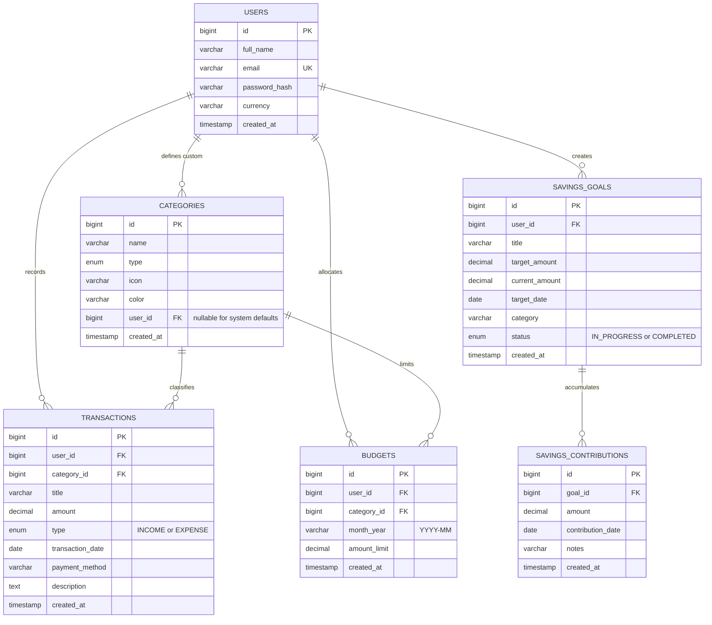

# ARTHIK — Personal Finance Management System

ARTHIK is a personal finance management web application designed for students and young professionals. It enables users to track income and expenses, monitor monthly spending caps, plan savings goals with ACID-guaranteed deposits, and explore spending analytics powered by classical computer science algorithms.

---

## 1. System Architecture

- **Frontend**: React 18, Vite, React Router v6, Axios, Recharts, Lucide React, Modern Gen Z Fintech CSS Design System.
- **Backend**: Java 19/21, Spring Boot 3.3, Spring Web (REST APIs), Spring JDBC (`JdbcTemplate`), Spring Validation, BCrypt Password Encoder, JJWT.
- **Database**: MySQL 8.0+ / 9.1 (`arthik_db`).
- **Academic Focus**: ADSA (Merge Sort & Max Heap), DBMS (Normalization 1NF-3NF & ACID Transactions), Java OOPs (Abstraction, Inheritance & Polymorphism).

---

## 2. Entity-Relationship (ER) Diagram



---

## 3. Academic Integration Summary

### A. ADSA (Advanced Data Structures and Algorithms)

1. **Merge Sort (`TransactionMergeSort.java`)**:
   - **Purpose**: Dynamically sorts transaction history by monetary `amount` or `date` in ascending or descending order.
   - **Recurrence Relation**: $T(N) = 2T(N/2) + \Theta(N)$
   - **Time Complexity**:
     - Best Case: $O(N \log N)$
     - Average Case: $O(N \log N)$
     - Worst Case: $O(N \log N)$
   - **Space Complexity**: $O(N)$ auxiliary space.
   - **Stability**: Stable (preserves insertion order of equal elements).

2. **Binary Max Heap (`CategoryMaxHeap.java`)**:
   - **Purpose**: Evaluates category spending records and extracts the Top 5 expense categories.
   - **Heap Property**: For every node $i$, $\text{value}(i) \le \text{value}(\text{parent}(i))$. Root always holds the maximum spender.
   - **Time Complexity**:
     - Bottom-up Heapify: $O(K)$ where $K$ is the number of distinct expense categories.
     - Root Extraction (`extractMax`): $O(\log K)$
     - Top $M$ Categories: $O(K + M \log K)$ — significantly faster than full array sorting for large sets of categories.

### B. DBMS (Database Management Systems)

1. **Database Normalization**:
   - **1NF**: Atomic values for all fields (no repeated groups or multivalued attributes). Primary keys defined on every table.
   - **2NF**: All non-key attributes are fully functionally dependent on the entire primary key.
   - **3NF**: Elimination of transitive dependencies. Category properties (color, icon, default classification) are isolated into `categories` rather than duplicated inside `transactions`.
2. **ACID Transactions (`SavingsService.java`)**:
   - Spring `@Transactional(rollbackFor = Exception.class)` protects the goal contribution pipeline.
   - When depositing money into a savings goal:
     1. An entry is inserted into `savings_contributions`.
     2. `savings_goals.current_amount` is incremented, and status is evaluated.
   - If either operation throws an exception, all changes are rolled back automatically.

### C. Java OOPs (Object-Oriented Programming)

1. **Abstraction & Inheritance**:
   - Abstract class `Transaction` defines shared state (`title`, `amount`, `transactionDate`, `paymentMethod`, `category`).
   - Abstract methods:
     - `abstract BigDecimal calculateNetImpact();`
     - `abstract String getDisplayType();`
2. **Polymorphism & Method Overriding**:
   - Subclass `IncomeTransaction` overrides `calculateNetImpact()` to return positive `+amount`.
   - Subclass `ExpenseTransaction` overrides `calculateNetImpact()` to return negative `-amount`.
   - The Spring JDBC `RowMapper` dynamically instantiates the correct subclass depending on the database column `type`.
3. **Monetary Precision**:
   - Uses `java.math.BigDecimal` throughout all models, DTOs, and services to prevent binary floating-point rounding errors.

---

## 4. How to Run the Project

### Database Setup (MySQL Workbench)
1. Open **MySQL Workbench** and connect to your local MySQL instance.
2. Open `ARTHIK/database/schema.sql` and click the **Lightning Bolt (Execute)** icon to create the database schema.
3. Open `ARTHIK/database/sample_data.sql` and execute it to populate sample data.

### Backend Setup (Spring Boot)
1. Open PowerShell and navigate to the backend:
   ```powershell
   cd "c:\Users\ANKUR MITTAL\Desktop\ARTHIK\backend"
   ```
2. Verify MySQL password in `src/main/resources/application.properties` (or set `$env:DB_PASSWORD="your_password"`).
3. Run the Spring Boot backend:
   ```powershell
   mvn spring-boot:run
   ```
   The backend will start at `http://localhost:8080`.

### Frontend Setup (React + Vite)
1. In another PowerShell terminal:
   ```powershell
   cd "c:\Users\ANKUR MITTAL\Desktop\ARTHIK\frontend"
   npm run dev
   ```
2. Open your browser at `http://localhost:5173`.
3. Login using demo credentials:
   - **Email**: `akarsh@arthik.com`
   - **Password**: `password123`
